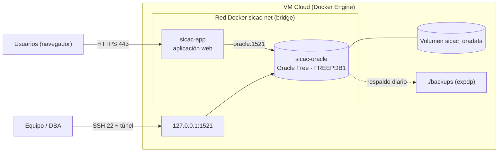

# SICAC — Arquitectura Docker + Oracle Database Free

Cubre el punto 3.3 del enunciado (entregable 8) y la base del manual técnico (entregable 16).

## 1. Arquitectura



| Componente | Detalle |
|---|---|
| Imagen | `container-registry.oracle.com/database/free` (oficial, variante Full) |
| Base | CDB `FREE`, PDB `FREEPDB1` (aquí vive todo SICAC) |
| Persistencia | Volumen nombrado `sicac_oradata` → `/opt/oracle/oradata` |
| Red | `sicac-net`; la app llega a la base como `oracle:1521/FREEPDB1` |
| Puerto 1521 | Publicado solo en `127.0.0.1` de la VM |
| Cuentas | `SYS`/`SYSTEM` (administración), `SICAC` (dueña del esquema), `SICAC_APP` (aplicación) |

Se usa la variante **Full** y no la Lite: la Lite es más liviana pero quita funciones, y el proyecto necesita las de seguridad y auditoría completas.

## 2. Requisitos

- VM con **2 vCPU, 4 GB de RAM y 30 GB de disco** como mínimo (la imagen pesa unos 3,6 GB y Oracle Free usa hasta 2 GB de RAM).
- Docker Engine con el plugin Compose (`docker compose version`).
- `sudo systemctl enable docker` para que los contenedores vuelvan tras reiniciar la VM.
- Firewall de la nube: abrir solo 22 (SSH) y 80/443 (aplicación). **Nunca 1521.**

## 3. Primer arranque

```bash
cp .env.example .env && chmod 600 .env
nano .env                         # completar las tres contraseñas
docker compose up -d
docker compose logs -f oracle     # esperar "DATABASE IS READY TO USE!"
docker compose ps                 # debe decir (healthy)
```

Al crear la base, `db/setup/01_crear_esquema.sh` crea el tablespace `SICAC_DATA`, los usuarios `SICAC` y `SICAC_APP` y el directorio de respaldos. Verificación:

```bash
docker exec -it sicac-oracle sqlplus sicac@//localhost:1521/FREEPDB1
SQL> SELECT SYSTIMESTAMP FROM dual;      -- debe mostrar hora de Bolivia (-04:00)
```

Si el usuario no existe, lanzar el script a mano (es idempotente):

```bash
docker exec sicac-oracle bash /opt/oracle/scripts/setup/01_crear_esquema.sh
```

Después del primer `pull`, anotar la versión exacta de la imagen y fijarla en `ORACLE_IMAGE` del `.env` (no dejar `latest`).

## 4. Conexión

- **Aplicación (misma red Docker):** host `oracle`, puerto `1521`, servicio `FREEPDB1`, usuario `SICAC_APP`.
- **SQL Developer / DBeaver desde su laptop:** abrir un túnel SSH y conectar a `localhost:1521`, servicio `FREEPDB1`.

```bash
ssh -N -L 1521:127.0.0.1:1521 usuario@IP_DE_LA_VM
```

Cada integrante entra con su propia llave SSH (acceso colaborativo sin compartir cuentas).

## 5. Inicio, detención y recuperación de servicios

| Acción | Comando |
|---|---|
| Iniciar | `docker compose up -d` |
| Detener (conserva datos) | `docker compose stop` |
| Reiniciar la base | `docker compose restart oracle` |
| Eliminar contenedores y red (conserva datos) | `docker compose down` |
| Estado y salud | `docker compose ps` |
| Logs | `docker compose logs -f oracle` |
| Consola SQL como administrador | `docker exec -it sicac-oracle sqlplus / as sysdba` |

## 6. Prueba de persistencia (condición de aceptación 2, E-13, CA-18)

```bash
docker exec -it sicac-oracle sqlplus sicac@//localhost:1521/FREEPDB1
SQL> CREATE TABLE prueba_persistencia (id NUMBER, creado TIMESTAMP DEFAULT SYSTIMESTAMP);
SQL> INSERT INTO prueba_persistencia (id) VALUES (1);
SQL> COMMIT;
SQL> EXIT

docker compose down               # borra el contenedor, no el volumen
docker compose up -d              # esperar (healthy)

docker exec -it sicac-oracle sqlplus sicac@//localhost:1521/FREEPDB1
SQL> SELECT * FROM prueba_persistencia;     -- la fila sigue ahí
SQL> DROP TABLE prueba_persistencia PURGE;
```

Guardar capturas de cada paso: es la evidencia que pide el enunciado.

## 7. Respaldo y recuperación (RS-09, RDI-04, RDI-05)

```bash
./scripts/backup.sh                                   # genera backups/sicac_FECHA_HORA.dmp
./scripts/restore.sh backups/sicac_FECHA_HORA.dmp     # pide confirmación
```

- Respaldo diario a las 03:00 (`crontab -e`):
  `0 3 * * * cd /ruta/al/proyecto && ./scripts/backup.sh >> backups/backup.log 2>&1`
- Se conservan 7 días en la VM (`RETENCION_DIAS`). Copiar los `.dmp` fuera de la VM.
- **Prueba de recuperación:** hacer un respaldo, borrar filas de una tabla, restaurar y comparar `SELECT COUNT(*)` antes y después. Medir el tiempo: es el RTO real.
- La restauración reemplaza tablas y datos. Vistas, funciones, procedimientos y secuencias existentes no se tocan; el código se vuelve a aplicar desde los scripts del repositorio.

## 8. Reconstrucción desde cero (RNF-06)

```bash
docker compose down -v            # ¡BORRA el volumen y todos los datos!
docker compose up -d
```

Para que la base quede completa con un solo comando, agregar a `db/setup/` los scripts numerados (`02_ddl.sql`, `03_plsql.sql`, `04_datos.sql`). La imagen los ejecuta como SYSDBA en la raíz del CDB, así que cada uno debe empezar con:

```sql
ALTER SESSION SET CONTAINER = FREEPDB1;
ALTER SESSION SET CURRENT_SCHEMA = SICAC;
```

## 9. Decisiones de seguridad (insumo para la matriz)

| Decisión | Requerimiento | Cómo evidenciarlo |
|---|---|---|
| 1521 solo en `127.0.0.1`; acceso remoto por túnel SSH | RS-06, CA-17 | `nc -zv IP_PUBLICA 1521` desde fuera falla; `docker ps` muestra `127.0.0.1:1521` |
| Credenciales en `.env` fuera del repositorio | RS-07 | `.gitignore`; `git log -- .env` vacío |
| Cuentas separadas: administración, dueña del esquema y aplicación | RS-01, RS-04 | `SELECT username FROM dba_users` |
| `SICAC_APP` nace solo con `CREATE SESSION` | RS-02, RS-05 | `SELECT * FROM dba_sys_privs WHERE grantee = 'SICAC_APP'` |
| Volumen nombrado y `restart: unless-stopped` | RDI-01, RDI-02 | Prueba de la sección 6 |
| Respaldo diario y restauración probada | RS-09, RDI-04, RDI-05 | Logs de `backup.sh` y `restore.sh` |

Docker publica los puertos saltándose UFW; por eso el puerto se enlaza a `127.0.0.1` en el propio `docker-compose.yml` y no se confía solo en el firewall del sistema operativo.

Limitación conocida: las contraseñas son visibles con `docker inspect` para quien ya tenga acceso a Docker en la VM. Restringir el grupo `docker` a los integrantes.

## 10. Problemas frecuentes

| Síntoma | Causa y solución |
|---|---|
| No existe el usuario `SICAC` | El volumen ya existía y el setup no corrió: lanzar el script a mano (sección 3) |
| `Permission denied` al leer `db/setup` | Host con SELinux: cambiar `:ro` por `:ro,z` en el compose |
| El contenedor se reinicia solo | VM con menos de 4 GB de RAM |
| La app no conecta al arrancar | La base aún no está `healthy`; usar `depends_on` con `service_healthy` |
| `backup.sh` falla con ORA-01017 | Cambiaron la contraseña de SYSTEM: actualizar `ORACLE_PWD` en `.env` y `docker compose up -d` |
| El `pull` pide autenticación | `docker login container-registry.oracle.com` con una cuenta Oracle gratuita |

Cambio de contraseña de SYS/SYSTEM/PDBADMIN:

```bash
docker exec sicac-oracle /opt/oracle/setPassword.sh NUEVA_CLAVE
```
